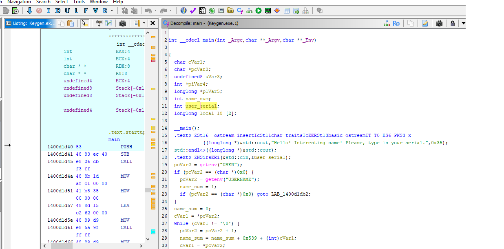
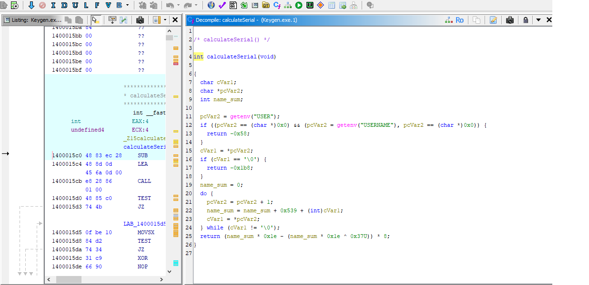

# Keygen Me (crazy_bg) - Static Analysis

Source: crackmes.one, "crazy_bg's Keygen Me!" (the exe is not included here)

## File info
- Format: PE64 (Windows, 64-bit), AMD64
- Compiler: see Detect It Easy result
- Packed: no (Detect It Easy reported not packed)
- Tools: Detect It Easy, Ghidra, Python
- Method: static analysis only, the program was never run

## How I found the check
1. Opened the file in Ghidra and looked at Defined Strings.
2. Found the success message "Serial correct! You WIN!!!" and used Show References to jump to the code that prints it.
3. Read `main` and then `calculateSerial` in the decompiler.

## Findings
The serial is not fixed. It is calculated from the Windows username (read from the USER or USERNAME environment variable):

1. For each character of the username, add 1337 (0x539) plus the character code to a running sum.
2. Compute `a = sum * 30`.
3. Expected serial = `(a - (a XOR 0x37)) * 8`, as a signed 32-bit integer.

`main` checks the typed serial against this formula and also against the result of `calculateSerial()`, which uses the same calculation, so both checks require the same value.

## Observation
The XOR with 0x37 only changes the lowest 6 bits, so `a - (a XOR 0x37)` always stays between -55 and 55. The final serial is therefore always between -440 and 440, no matter how long the username is.

## Keygen
See `keygen.py`. Change the `name` line to the username you want a serial for.

## Screenshots

## Notes
The serial was calculated from the decompiled code but not tested by running the program. I plan to confirm it in an isolated VM once I have a lab set up.
